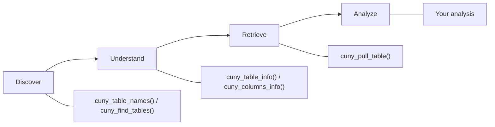

# CUNYsports

`CUNYsports` (0.1.1) is an R package for accessing and exploring collegiate athletics data from the **City University of New York (CUNY)**.

The package provides a simple interface for retrieving sports data from an included SQLite database. The database contains information about teams, players, games, seasons, schools, opponents, and other aspects of CUNY athletics.

**Currently, only basketball-related data are available. Work is underway to expand coverage to additional sports.**

The project is part of the **CUNY Sports Analytics Initiative** at [The Open Data Lab](https://martinezc1-nyc-open-data-lab.share.connect.posit.cloud/).

## Overview

CUNY athletics data are publicly available across individual college athletics websites. However, the information is distributed across sources and is not always easy to access or combine.

`CUNYsports` provides a centralized and reproducible way to work with these data in R.

The package includes:

- An included SQLite database containing cleaned CUNY athletics data
- Functions for discovering available tables
- Search tools for finding relevant datasets
- Table-level and column-level documentation
- Functions for retrieving complete tables into R
- Direct database access for advanced users
- Consolidated analytical tables that reduce the need for manual joins
- Data-quality audit records documenting excluded player records

The package supports sports analytics, student research, dashboards, scouting reports, data visualization, teaching, and other analyses of CUNY athletics.

## Sports Coverage

The current release focuses on **CUNY men's and women's basketball**.

Basketball data include:

- Team and opponent statistics
- Player-season statistics
- Conference statistics
- Scoring statistics and player averages
- Game-by-game results and performance statistics
- Combined team-versus-opponent game records
- Team and individual game highs
- Category leaders
- Records excluded during player-data cleaning
- Schools, seasons, players, games, and opponents

The project is designed to expand to additional CUNY sports over time.

## Installation

Install the CRAN release with:

```r
install.packages("CUNYsports")
```

Or install the development version from GitHub:

```r
devtools::install_github("nyc-open-data-lab/CUNYsports")
```

Then load the package:

```r
library(CUNYsports)
```

## Getting Started

`CUNYsports` provides a small set of functions for exploring and accessing the database.

### View Available Tables

Use `cuny_table_names()` to see the tables available in the installed database.

```r
cuny_table_names()
```

### Search for Tables

If you know what kind of data you want but not the exact table name, use `cuny_find_tables()`.

```r
cuny_find_tables("basketball")
cuny_find_tables("player")
cuny_find_tables("game")
cuny_find_tables("scoring")
```

The function searches the package's table catalog and returns tables whose metadata match the search term.

### Learn About a Table

Use `cuny_table_info()` to view table-level documentation.

```r
cuny_table_info("basketball_player_season_stats")
```

Table metadata include descriptions, data grain, season coverage, sources, candidate keys and relationships, likely analytical uses, and notes.

### Learn About the Columns

Use `cuny_columns_info()` to view documentation for variables within a table.

```r
cuny_columns_info("basketball_game_by_game_combined")
```

The column catalog describes variable names, suggested names, data types, example values, key roles, and notes.

### Pull a Table into R

Use `cuny_pull_table()` to retrieve a complete database table as an R data frame.

```r
player_stats <- cuny_pull_table("basketball_player_season_stats")
```

Then use standard R tools:

```r
library(dplyr)

player_stats |>
  filter(gender == "W")
```

For men's basketball:

```r
player_stats |>
  filter(gender == "M")
```

## Recommended Analytical Tables

Three additional tables make common analyses easier and document important cleaning decisions.

| Table | What it contains | Good starting point for |
|---|---|---|
| `basketball_player_season_stats` | Consolidated player-season records, including overall statistics, conference statistics, and career-high fields | Player comparisons, development, leaderboards, and scouting |
| `basketball_game_by_game_combined` | One record per scraped school-game perspective, with team and opponent statistics in the same row | Matchup analysis, game trends, dashboards, and retrospective performance analysis |
| `basketball_player_records_removed` | Player records excluded by the cleaning process, with source and removal metadata | Auditing, troubleshooting, and data-quality review |

These tables complement rather than replace the more detailed source-oriented tables in the database.

### Player-Season Analysis

`basketball_player_season_stats` brings together player-season statistics and related conference and career-high information, reducing the need to combine multiple player tables manually.

```r
library(CUNYsports)
library(dplyr)

players <- cuny_pull_table("basketball_player_season_stats")

players |>
  select(
    player_name,
    season_label,
    school,
    gender,
    games_played,
    points_per_game,
    rebounds_per_game,
    assists
  ) |>
  arrange(desc(points_per_game))
```

The table also includes identifiers such as `player_id`, `school_id`, and `season_id`, plus conference-specific statistics and career-high fields. Check the column documentation for field definitions and availability.

### Game-by-Game Team and Opponent Analysis

`basketball_game_by_game_combined` places team and opponent box-score statistics side by side, so users can compare both performances without joining the separate game tables themselves.

```r
games <- cuny_pull_table("basketball_game_by_game_combined")

games |>
  select(
    school,
    opponent_name,
    season_label,
    game_date,
    result,
    point_differential,
    total_rebounds,
    opponent_total_rebounds,
    outrebounded_opponent
  )
```

The table includes derived indicators such as:

- `is_close_game`: absolute point differential of five points or fewer
- `is_blowout`: absolute point differential of at least 20 points
- `outrebounded_opponent`: the scraped team had more rebounds than its opponent
- `outshot_opponent`: the scraped team had a higher field goal percentage
- `fewer_turnovers`: the scraped team committed fewer turnovers than its opponent

**Modeling note:** These indicators describe completed games. They should not be used as same-game predictors of wins or losses because doing so would introduce information from after the game into the model. For prospective predictions, construct features using only information available before tipoff.

### Data-Quality Audit Records

`basketball_player_records_removed` preserves information about player records excluded during cleaning.

```r
removed_records <- cuny_pull_table("basketball_player_records_removed")

removed_records |>
  count(removal_reason, sort = TRUE)
```

Fields such as `source_table`, `source_row_id`, `removal_reason`, `duplicate_count`, and `record_rank` help users inspect and understand cleaning decisions. This is an audit table, not the recommended source for ordinary player analysis.

## Typical Workflow

A typical `CUNYsports` workflow looks like this:

```r
library(CUNYsports)
library(dplyr)

# Discover available datasets
cuny_table_names()
cuny_find_tables("player")

# Read the documentation
cuny_table_info("basketball_player_season_stats")
cuny_columns_info("basketball_player_season_stats")

# Retrieve an analysis-ready dataset
players <- cuny_pull_table("basketball_player_season_stats")

# Begin analysis
players |>
  filter(gender == "W") |>
  arrange(desc(points_per_game))
```

The workflow follows four steps:



## Database Structure

`CUNYsports` stores its athletics data in an included SQLite database. The database contains analytical tables and reusable dimension tables.

### Basketball Tables

The database contains both detailed source-oriented tables and consolidated analysis-ready tables covering:

- Season-level team statistics
- Player overall, conference, scoring, and average statistics
- Team summary statistics
- Game-by-game team and opponent statistics
- Game-by-game comparisons
- Consolidated player-season statistics
- Combined team and opponent game statistics
- Player cleaning audit records
- Team and individual game highs
- Category leaders

Men's and women's basketball records are stored together in applicable tables and can be distinguished using the `gender` variable.

### Dimension Tables

Shared dimensions provide standardized identifiers and attributes:

- `dim_seasons`
- `dim_schools`
- `dim_players`
- `dim_games`
- `dim_opponents`
- `dim_player_year`

These dimensions support consistent joins and longitudinal analysis across the database. In the combined game table, `school_id` and `game_id` identify the school-specific game perspective and are the recommended candidate composite key, subject to uniqueness validation.

## Direct Database Access

Advanced users can access the SQLite database directly with `cuny_db()`.

```r
con <- cuny_db()
DBI::dbListTables(con)
```

The connection can also be used with database-backed workflows:

```r
dplyr::tbl(con, "basketball_game_by_game_combined")
```

When finished, disconnect:

```r
DBI::dbDisconnect(con)
```

For most users, `cuny_pull_table()` provides the simplest way to retrieve data.

## Core Functions

| Function | Purpose |
|---|---|
| `cuny_table_names()` | View all available database tables |
| `cuny_find_tables()` | Search for tables using catalog metadata |
| `cuny_table_info()` | View documentation for a table |
| `cuny_columns_info()` | View documentation for columns in a table |
| `cuny_pull_table()` | Retrieve a complete table into R |
| `cuny_db()` | Open a direct connection to the SQLite database |

## Data Documentation

Two catalogs are included with the package:

### `table_catalog`

Contains table-level metadata describing the structure, coverage, relationships, and potential uses of each database table.

### `column_catalog`

Contains column-level metadata describing each variable's meaning, suggested name, data type, example values, and database role.

The helper functions `cuny_table_info()` and `cuny_columns_info()` provide convenient access to these catalogs. The three consolidated and audit tables are documented alongside the existing tables.

## Data Sources and Cleaning

The underlying data are derived from publicly available CUNY athletics websites. The data engineering pipeline collects and standardizes information across institutions and seasons before constructing relational tables for distribution through the package.

Recent pipeline improvements include:

- Separating game-level records from season summary rows
- Aligning team and opponent game statistics using school and game identifiers
- Consolidating player-season information across statistical views
- Preserving excluded player records in an audit table
- Adding derived game-level comparison indicators
- Maintaining table-level and column-level documentation

Because source websites and historical records can vary, users should consult the documentation and validate completeness for their specific research question.

## CUNY Sports Analytics Initiative

`CUNYsports` is part of the **CUNY Sports Analytics Initiative**, a project of The Open Data Lab focused on building open data infrastructure for CUNY athletics.

The broader initiative supports:

- Sports analytics and historical analysis
- Scouting reports
- Interactive dashboards
- Student research and teaching
- Data visualization
- Open-source software
- Sports journalism and storytelling
- Exploratory and predictive analytics

The goal is not simply to collect athletics data, but to make them easier for students, researchers, coaches, fans, and the broader CUNY community to explore and use.

## Future Development

Planned areas of development include:

- Additional CUNY sports, including volleyball
- Expanded historical coverage
- Additional helper functions
- Improved database documentation
- Automated data validation and testing
- Tutorials and example analyses
- Integration with CUNY sports dashboards and other public-facing projects

## About

`CUNYsports` is developed as part of [The Open Data Lab](https://martinezc1-nyc-open-data-lab.share.connect.posit.cloud/), an open-source initiative focused on making public and institutional data easier to access, analyze, and use.

The package is developed and maintained by **Christian Martinez** with contributions from students and collaborators working on the CUNY Sports Analytics Initiative.

## License

`CUNYsports` is released under the MIT License.
